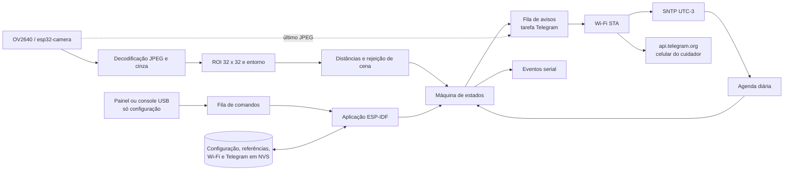

# Arquitetura e rastreabilidade

## Base documental e decisões

`Tarefa 02 - Turma 3.docx` é o texto consolidado e detalha os requisitos RF01–RF12/RNF01–RNF11. `Projeto_Auditor_Visual_Medicacao.docx` e a apresentação descrevem o protótipo inicial. `Documento de Proposta PCS-USP_.docx` descreve uma alternativa anterior com CNN, RTC, deep sleep e outra placa; essa arquitetura não é exigida pelo escopo mínimo consolidado e não cabe na lista atual de materiais. Os PDFs ESP32 são referências gerais do chip e de Bluetooth, não esquemas da câmera da placa comercial. Bluetooth não é usado.

A implementação troca o ESP32-S3 pelo ESP32 clássico escolhido pelo grupo. **Revisão de escopo (MVP autônomo, 10/2026):** o aparelho deve funcionar apenas ligado a uma fonte, sem computador. O computador só configura (Wi-Fi, Telegram, horário, ROI e calibração). A hora vem do SNTP, a verificação é diária e automática, e o cuidador é avisado pelo Telegram, com foto nos casos que exigem conferência. Buzzer e botão saíram do escopo por decisão do grupo: o aviso é remoto. O MVP cobre um compartimento e uma dose por dia; o organizador semanal de 7 compartimentos fica como extensão. Nenhum modelo de IA pré-treinado foi apresentado como classificador de medicamentos.

## Fluxo

O núcleo em `components/auditor` não depende de FreeRTOS, câmera ou relógio de parede: recebe a hora local em segundos para calcular a próxima janela (`next_window_offset`) e trabalha com milissegundos monotônicos na máquina de estados (`Cycle`). `main/camera.cpp` é o único proprietário do driver e guarda o último JPEG analisado. `main/storage.cpp` preserva um único blob de configuração/referências. `main/network.cpp` mantém o Wi-Fi com reconexão por backoff e o SNTP. `main/notify.cpp` envia ao Telegram numa tarefa própria, com fila e novas tentativas, para que o HTTPS nunca atrase as capturas. `main/app_main.cpp` serializa comandos, aquisição, agenda e transições; uma segunda tarefa recebe bytes UART. As gravações NVS ocorrem só ao configurar/calibrar, nunca em cada quadro. O watchdog de tarefas reinicia a placa se o laço principal travar; o aviso de boot informa o motivo.

## Visão

A captura usa JPEG QQVGA e um único framebuffer DRAM para não pressupor PSRAM. O primeiro buffer é descartado a cada captura para evitar reutilização de uma imagem anterior. Antes de decodificar, confere-se o tamanho do JPEG, limitando a saída ao buffer RGB. A imagem é convertida em cinza com pesos inteiros. O recorte é reduzido por médias de blocos a 1024 intensidades; uma grade de até 192 pontos acompanha o entorno, excluindo os pontos dentro da ROI e normalizando pela quantidade efetivamente usada.

A comparação com as referências usa a **média das 10% maiores diferenças** entre as 1024 células da ROI, sem depender de treinamento. Um comprimido pequeno muda poucas células com força; a média da ROI inteira o diluiria abaixo do ruído do JPEG (na bancada, um comprimido em ~4% da ROI deu 5,3 pela média e 31,8 pelo top 10%, contra ruído de 2,7 e 8,9). Se o comprimido muda de lugar, ele difere das duas referências e a leitura fica inconclusiva, nunca “vazio”. A estabilidade entre quadros e o entorno continuam usando a média, adequada para movimento e luz globais. Uma classe só é aceita se:

1. As duas referências estão válidas e suficientemente separadas.
2. A imagem não é predominantemente escura ou saturada.
3. O entorno permanece próximo de uma referência.
4. A diferença entre as distâncias às duas classes supera a margem.
5. A distância à referência escolhida está abaixo do menor valor entre o limiar configurado e 45% da distância entre referências.

Cada observação adquire dois quadros e exige estabilidade espacial entre eles. A calibração agrega cinco quadros comparados ao primeiro. A persistência de vazio é avaliada novamente entre observações da agenda. Esses mecanismos reduzem a influência de mãos e movimento, mas não garantem rejeição universal: uma oclusão visualmente semelhante ao vazio pode confundir o método. O teste óptico independente é obrigatório antes de atribuir desempenho.

## Agenda e resultados

A agenda é diária e automática. Quando nada está pendente e há hora válida, câmera e calibração, a aplicação converte a próxima ocorrência do horário civil em uma janela monotônica `[início, fim]` e arma o ciclo. A deriva entre o relógio monotônico e o SNTP é de poucos segundos por dia; a janela de cada dia é recalculada a partir do relógio civil. Se o aparelho liga com a janela de hoje aberta, ela é retomada com o tempo restante. Depois de concluída, a janela do mesmo dia nunca é repetida.

A presença da dose é verificada dentro da janela, não no armamento: o cuidador repõe a dose a qualquer momento antes do horário. Retirada (`removed`) exige a dose ter sido vista e depois `confirmations` leituras vazias consecutivas. Vazio persistente sem presença vista resulta em `not_loaded` (dose não reposta ou retirada antes da hora). O próximo intervalo conta da conclusão da leitura, sem rajadas de recuperação após lentidão. Capturas concluídas depois do limite não podem confirmar retirada. Um intervalo entre observações maior que o configurado mais 2 s quebra a sequência de confirmação.

No fim da janela, somente uma observação recente `present` permite `alert`; qualquer ausência de evidência ou um vazio ainda não confirmado resulta em `fault`. “Recente” significa até intervalo + 2 s. Em `alert`, a observação continua por `late_s`; uma retirada confirmada nesse período resulta em `late_removed`. `duration_ms` mede o custo completo de cada leitura para conferir RNF02.

Cada resultado gera um aviso no Telegram. `not_loaded`, `alert` e `fault` levam a foto da janela atual, para o cuidador conferir. Mensagens aguardam o Wi-Fi e são reenviadas com espera crescente. Após reset, a configuração continua salva; hora e verificação em andamento não: o aparelho espera o SNTP e nunca deduz retirada no período desligado.

## Requisitos

| Requisito | Implementação / limite |
|---|---|
| RF01 | `set`, `wifi`, `telegram`; painel/console USB só para configurar |
| RF02 | ROI e cinco amostras por referência em NVS |
| RF03 | Agenda diária automática a partir do SNTP; captura periódica durante a janela |
| RF04 | `classify`: presente, vazio, inconclusivo; vazio isolado não é resultado de retirada |
| RF05 | Presença vista na janela, persistência temporal e rejeição de cena; vazio sem presença vira `not_loaded` |
| RF06 | **Alterado:** aviso remoto pelo Telegram com foto, em vez de alerta sonoro local (decisão do grupo, sem buzzer) |
| RF07 | **Alterado:** sem botão; estados pela serial e pelo Telegram. Não há reconhecimento que vire retirada |
| RF08 | Eventos JSONL na serial (quando conectada) e resultados diários no Telegram |
| RF09 | Falha de captura gera inconclusivo/`fault` com aviso; sem hora a agenda não arma; câmera é reiniciada fora da janela |
| RF10 | **Alterado:** NVS; após reset a hora volta pelo SNTP e a agenda se rearma sozinha. Não infere retirada no período desligado |
| RF11 | **Alterado:** rearmamento automático diário; a presença é verificada na janela seguinte |
| RF12 | **Obrigatório no MVP:** Telegram por Wi-Fi. Sem rede, captura e decisão continuam e os avisos ficam na fila |
| RNF01 | Aquisição, classificação, agenda e decisão no ESP32 clássico |
| RNF02 | Instrumentação implementada; tempo precisa ser medido na placa |
| RNF03 | Avaliador de logs + ensaio de bancada; metas não presumidas |
| RNF04 | Registro de condições de ensaio no protocolo de validação |
| RNF05 | **Alterado:** a decisão independe da rede; o aviso ao cuidador depende do Wi-Fi e é reenviado quando ele volta |
| RNF06 | Heap mínimo (`min_heap`) no status, watchdog e protocolo de 20 ciclos; ensaio real pendente |
| RNF07 | Fonte USB 5 V / 2 A recomendada (Wi-Fi + câmera); brownout é informado no aviso de boot |
| RNF08 | Roteiro de configuração no README; estados no painel e no Telegram |
| RNF09 | **Alterado:** processamento local; foto 160 × 120 da caixa enviada só ao chat do cuidador em `not_loaded`/`alert`/`fault` |
| RNF10 | Núcleo, câmera, NVS, aplicação e ferramentas separados; testes e CI |
| RNF11 | Placa + caixa; sem compras eletrônicas adicionais pressupostas |

## Fontes técnicas

- [ESP32 Camera Driver](https://github.com/espressif/esp32-camera/tree/v2.0.16): aquisição OV2640/ESP32.
- [Suporte de chips e placas ESP-VISION](https://docs.espressif.com/projects/esp-vision/en/latest/esp32p4/target-support/index.html): a tabela consultada não inclui ESP32 clássico.
- [System Time ESP-IDF](https://docs.espressif.com/projects/esp-idf/en/v5.4.2/esp32/api-reference/system/system_time.html): relógio civil e timers internos.
- [Plataforma PlatformIO 6.11.0](https://github.com/platformio/platform-espressif32/blob/v6.11.0/platform.json): distribuição do ESP-IDF 5.4.1.
- [RoboCore, módulo escolhido](https://www.robocore.net/wifi/esp32-cam-com-gravador-integrado): características e limitações da placa comercial.

Consulta em 25/09/2026. A versão de cada dependência é fixada no projeto; links `latest` servem para justificar a escolha, não para resolver builds implicitamente.
